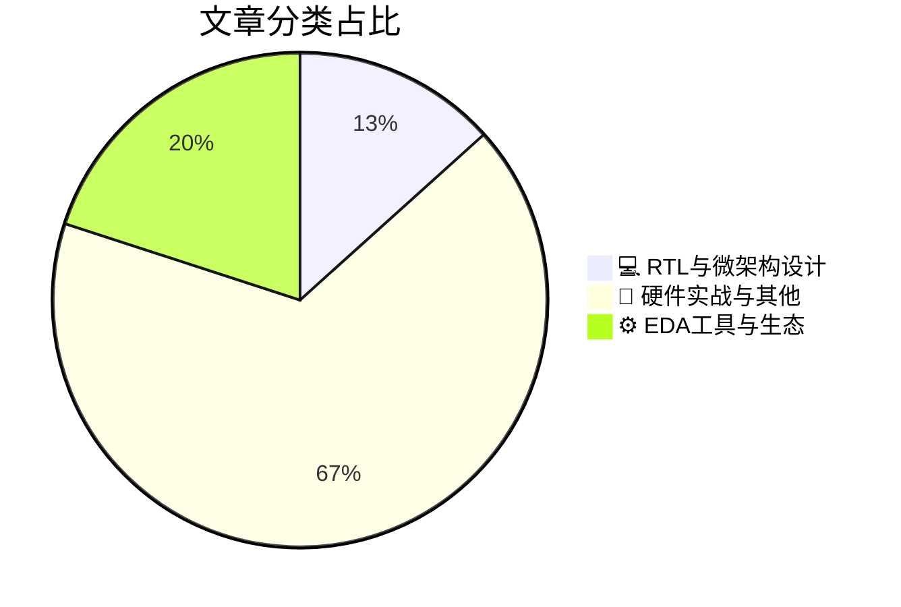

# 🛠️ FPGA / 验证技术精选

> 生成时间：2026-10-13 14:25:10 | 数据范围：过去 96 小时

## 📝 行业视点

当前硬件验证领域正涌现三大硬核趋势：AI加速器微架构层面正强化片上实时监控机制，以精准检测并缓解bit-flip攻击，提升RTL级可靠性与安全验证覆盖率；EDA工具链加速融入Agentic AI，推动设计自动化从传统脚本向自主代理演进，重塑验证流程与DAC生态；同时，针对AI内存瓶颈与边缘功耗墙，压缩IP、低压基础IP及高功率PSU方案密集落地，要求验证工程师深化对低电压域、功耗感知仿真与跨模态量子互联的形式化验证能力。

---

## 🏆 深度必读 (Top 3)

### 1. [片上监视器检测AI加速器中的比特翻转攻击（佛罗里达大学、德克萨斯大学达拉斯分校、伦斯勒理工学院）](https://semiengineering.com/on-chip-monitors-detect-bit-flip-attacks-in-ai-accelerators-uf-ut-dallas-rpi/)
**评分**: 6/10 | **分类**: 💻 RTL与微架构设计 | **标签**: `AI加速器` `片上监控器` `位翻转攻击` `硬件安全` `故障检测`

> **💡 推荐理由**：验证团队可直接借鉴其片上监控架构与故障注入检测方法，用于AI加速器安全验证、覆盖率增强及侧信道/故障攻击测试用例设计，有效弥补传统功能验证在硬件安全威胁上的盲区，提升芯片鲁棒性验证效率。

**摘要**：
本文提出在AI加速器中集成片上监视器，用于实时检测针对神经网络权重或激活值的比特翻转攻击（如故障注入或Rowhammer类攻击）。该方案解决了AI硬件加速器在面对恶意故障注入时缺乏高效、低开销运行时检测机制的架构设计痛点，传统验证方法难以覆盖动态安全威胁。通过监控关键信号异常或计算一致性，监视器能及时发现并报告攻击，提升系统安全性。文章重点讨论了监视器的硬件实现、检测精度与面积/功耗开销权衡，以及在FPGA/ASIC上的验证策略。这为数字IC验证团队提供了针对AI芯片安全属性的新型验证思路和测试基准。

### 2. [MicroZed Chronicles：伦敦FPGA Horizons：AI、安全与FPGA工程的未来](https://www.adiuvoengineering.com/post/microzed-chronicles-fpga-horizons-london-ai-security-and-the-future-of-fpga-engineering)
**评分**: 5/10 | **分类**: 📝 硬件实战与其他 | **标签**: `FPGA AI加速` `硬件安全` `FPGA工程趋势` `行业展望`

> **💡 推荐理由**：验证团队可从中获取AI加速器与安全IP在FPGA上的最新验证策略与架构洞察，帮助解决异构系统覆盖率、安全属性验证及未来工具链适配等实际痛点，提升复杂SoC/FPGA项目的验证效率与质量。

**摘要**：
文章报道了伦敦FPGA Horizons活动，聚焦AI加速、硬件安全与FPGA工程未来趋势。核心讨论了在FPGA上部署AI推理时面临的验证痛点，如异构计算架构中软硬件协同验证的复杂性、时序与资源约束下的功能覆盖不足。同时强调安全设计中的架构问题，包括侧信道攻击防护、安全启动与加密IP的形式化验证挑战。活动还探讨了未来FPGA工具链与验证方法学的演进，以应对日益增长的系统级复杂度和可靠性需求。这些内容直接针对验证团队在AI-FPGA融合与高安全应用中的架构设计与验证闭环难题。

### 3. [CTO Interview with Dr. Zakir Syed of ClockEdge](https://semiwiki.com/eda/clockedge/374633-cto-interview-with-dr-zakir-syed-of-clockedge/)
**评分**: 4/10 | **分类**: ⚙️ EDA工具与生态 | **标签**: `时钟域交叉（CDC）` `SoC验证` `半导体EDA` `验证自动化`

> **💡 推荐理由**：无

**摘要**：
摘要生成失败。

---

## 📊 资讯分布与高频标签

## 📋 更多分类好文

### 💻 RTL与微架构设计

- [**Chips&Media 以新压缩IP瞄准AI内存瓶颈**](https://semiwiki.com/ip/chipsmedia/374498-chipsmedia-targets-ai-memory-bottlenecks-with-new-compression-ip/) - *semiwiki.com* (4分)
  > 文章介绍Chips&Media推出的新型压缩IP，专门针对AI加速器中的内存带宽瓶颈问题，通过高效压缩权重和激活数据来显著降低内存访问需求。该IP在架构设计上优化了压缩比与延迟的平衡，支持与现有内存控制器和AI计算单元的无缝集成。核心验证痛点包括确保压缩/解压缩过程的数据完整性（无损或可控有损）、高吞吐场景下的功能正确性验证，以及带宽节省效果的系统级性能验证。文章还探讨了在FPGA原型验证和ASIC实现中面临的接口兼容性、功耗和时序收敛挑战。这些内容直接关联数字IC验证中对AI专用IP的覆盖率规划和断言设计。总体而言，该方案为解决AI芯片内存墙问题提供了可验证的架构思路。

### ⚙️ EDA工具与生态

- [**是德科技通过代理式AI推进其设计软件**](https://semiwiki.com/eda/374576-keysight-advances-its-design-software-with-agentic-ai/) - *semiwiki.com* (4分)
  > 文章介绍了Keysight将代理式人工智能（Agentic AI）深度集成到其设计软件平台中，以应对数字IC和FPGA验证中的核心挑战。传统验证流程常受困于仿真周期过长、复杂bug调试耗时以及功能覆盖率难以快速收敛等痛点。通过自主AI代理，软件可自动生成智能测试激励、实时分析失败日志并推荐架构级修复方案，显著缩短验证迭代时间。这直接解决了验证架构设计中人工依赖过高和可扩展性不足的问题，使团队能更高效地处理大规模SoC和FPGA设计。整体而言，该进展推动了从被动验证向主动智能验证的范式转变，提升了整体设计闭环效率。

- [**DAC 2027 开放投稿征集，AI 重塑芯片设计**](https://semiwiki.com/events/374512-dac-2027-opens-call-for-contributions-as-ai-reshapes-chip-design/) - *semiwiki.com* (2分)
  > 文章宣布DAC 2027会议正式开放投稿征集，聚焦AI技术如何全面重塑芯片设计与验证流程。随着生成式AI在RTL代码生成、架构探索和优化中的广泛应用，传统验证方法面临核心痛点：AI生成设计的可解释性差、功能覆盖率难以保证以及形式验证复杂度激增。文章深入探讨验证架构如何演进以适应AI驱动设计，重点解决异构SoC验证、ML加速器硬件正确性检查以及自动化测试激励可靠性等架构设计问题。强调亟需构建融合AI辅助的新型验证方法论，确保设计正确性、安全性和可调试性。这对验证团队提出了从工具链到方法论的系统性升级要求。

### 📝 硬件实战与其他

- [**Quantum Source 推出 QS-LINK 实现跨模态量子计算机的连接与扩展**](https://www.eejournal.com/industry_news/quantum-source-unveils-qs-link-to-connect-and-scale-quantum-computers-across-modalities/) - *eejournal.com* (4分)
  > 文章介绍了 Quantum Source 公司发布的 QS-LINK 技术，该技术旨在连接和扩展不同模态的量子计算机。它解决了量子计算系统中不同硬件平台之间互操作性差的问题，特别是在扩展量子比特数量和跨模态通信方面的架构挑战。对于验证团队而言，这涉及到复杂的接口协议验证、时序同步以及混合信号系统的验证痛点。QS-LINK 提供了一种标准化的链接方式，有助于简化大规模量子系统的设计和验证流程。通过支持多种量子模态的互连，它缓解了传统量子架构中的可扩展性瓶颈。

- [**使用低压基础IP克服边缘AI功耗墙**](https://semiwiki.com/artificial-intelligence/374757-overcoming-the-edge-ai-power-wall-with-low-voltage-foundation-ip/) - *semiwiki.com* (3分)
  > 文章聚焦边缘AI设备因算力需求激增而面临的功耗墙瓶颈，提出采用低压基础IP（如低电压标准单元库、SRAM和接口IP）作为核心解决方案，以显著降低动态与静态功耗。它详细分析了低电压操作带来的架构设计挑战，包括多电压域划分、时序收敛困难以及可靠性风险（如软错误和老化效应）。针对验证痛点，文章强调了在低电压条件下进行功耗完整性分析、跨电压域接口验证以及PVT角点覆盖的复杂性。通过实际案例展示了如何利用先进验证方法学（如形式验证与仿真结合）确保低压IP的正确集成与性能达标。最终，该方案帮助设计团队在边缘设备严格功耗预算下实现AI推理的能效优化，同时降低验证迭代成本。

- [**COSMAC：世界首款CMOS微处理器的漫长、真实且永无止境的故事（第二部分）**](https://www.eejournal.com/article/cosmac-the-long-true-and-never-ending-story-of-the-worlds-first-cmos-microprocessors-part-2/) - *eejournal.com* (3分)
  > 本文深入回顾了RCA COSMAC系列（尤其是CDP1802）作为世界首款商用CMOS微处理器的完整研发历程与架构演进细节，重点剖析了早期CMOS工艺下低功耗、高噪声容限与辐射硬化设计的关键权衡。文章揭示了在无现代EDA工具时代，验证团队面临的核心痛点：如何通过手工仿真、原型板级测试与有限的逻辑分析仪验证复杂的指令集架构（ISA）时序与中断处理正确性。它详细讨论了静态逻辑设计带来的异步电路验证挑战，以及如何确保在极端温度与太空环境下的功能完整性。通过真实案例展示了架构师如何解决功耗-性能-可靠性三角矛盾，为现代低功耗SoC验证提供了历史借鉴。整体强调了早期验证方法论对当今FPGA/ASIC验证流程的启示。

- [**聆听未来：深入 sensiBel 的光学 MEMS 革命**](https://www.eejournal.com/fish_fry/listening-to-the-future-inside-sensibells-optical-mems-revolution/) - *eejournal.com* (3分)
  > 文章详细剖析了 sensiBel 光学 MEMS 麦克风如何通过激光干涉传感架构彻底革新传统电容式 MEMS 设计，解决了高噪声、有限动态范围和电磁干扰敏感等核心性能瓶颈。它重点阐述了光学-机械-电子多物理场耦合系统的架构设计挑战，包括如何实现高精度光路对准与信号链的鲁棒性。针对验证痛点，文章指出传统数字验证方法难以覆盖 MEMS 非线性、环境漂移和光学噪声建模问题，提出了基于硬件加速仿真与混合信号形式验证的协同验证策略。通过可验证性设计（DfV）原则，团队能够提前发现架构级缺陷并确保量产一致性。最终，该方案为高保真音频 SoC 验证提供了可扩展的参考架构。

- [**碳点界面实现二维半导体上的超薄高κ电介质（UIUC、NETL、Argonne、Monash）**](https://semiengineering.com/carbon-dot-interface-enables-ultrathin-high-%ce%ba-dielectrics-on-2d-semiconductors-uiuc-netl-argonne-monash/) - *semiengineering.com* (2分)
  > 该文章提出利用碳点作为界面层，成功在二维半导体表面实现超薄高κ电介质的均匀高质量沉积。这直接解决了传统ALD工艺因2D材料表面惰性导致的成核困难、针孔缺陷、界面陷阱密度高和泄漏电流大等核心问题。在数字IC/FPGA验证架构中，这些界面缺陷会造成器件模型不准确、性能变异性剧增以及可靠性仿真偏差，极大增加了功耗、时序和功能验证的复杂度。通过碳点界面优化，文章显著提升了2D FET的栅控能力和电学稳定性，为超薄栅介质架构设计提供了可靠基础。验证团队可据此改进SPICE模型和PDK，减少硅前仿真与实测偏差，加速先进节点异质集成器件的验证闭环。

- [**芯片产业一周回顾**](https://semiengineering.com/chip-industry-week-in-review-159/) - *semiengineering.com* (2分)
  > 本文回顾了芯片行业本周的重要动态，重点关注先进制程和AI芯片的验证挑战。文章指出多芯片封装设计中的互连验证痛点，如信号完整性和热管理问题。它讨论了在复杂FPGA架构中实现高效覆盖率闭合的架构设计难题。针对仿真速度瓶颈，提出了使用硬件加速验证的解决方案。此外，还强调了软件硬件协同验证在系统级设计中的重要性。这些内容为验证工程师提供了应对当前技术趋势的实用见解。

- [**英飞凌推出面向下一代AI服务器电源架构的27 kW三相PSU解决方案**](https://www.eejournal.com/industry_news/infineon-introduces-27-kw-three-phase-psu-solution-for-next-generation-ai-server-power-architectures/) - *eejournal.com* (2分)
  > 本文介绍了英飞凌针对AI服务器高功耗需求推出的27 kW三相PSU参考解决方案，采用先进数字控制和功率器件实现高效三相功率转换。该方案重点解决了下一代AI数据中心电源架构中功率密度不足、转换效率低下以及动态负载波动下的稳定性问题。通过模块化三相设计和优化的PFC/LLC拓扑，它显著降低了谐波失真并提升了系统可靠性。对于数字IC/FPGA验证而言，文章揭示了验证复杂电源管理控制逻辑、实时故障检测与冗余切换机制的痛点。同时强调了在高电流瞬态和热约束下进行系统级验证的架构挑战。这为验证工程师提供了针对AI工作负载电源子系统的验证策略参考。

- [**机器人精度：iC-Haus亮相electronica与SPS 2026**](https://www.eejournal.com/industry_news/precision-for-robotics-ic-haus-at-electronica-and-sps-2026-at-this-years-autumn-trade-shows-ic-haus-focuses-on-highly-integrated-encoder-and-sensor-ics-for-precise-position-sensing/) - *eejournal.com* (2分)
  > 文章介绍了iC-Haus在electronica和SPS 2026秋季贸易展上重点展示的高度集成编码器与传感器iC，专为机器人精确位置传感设计。这些器件通过单芯片集成解决了多传感器融合与高精度位置反馈的架构挑战。核心验证痛点在于混合信号接口的时序精度、噪声鲁棒性以及实时位置解码的覆盖率不足。架构设计上强调了高度集成带来的验证复杂性，包括多协议兼容性与FPGA原型中的精度建模难题。文章提供了针对编码器IC的验证策略建议，帮助应对仿真与硅后验证中的精度偏差问题。整体聚焦于提升机器人控制系统的可靠位置传感验证效率。

- [**Viscom将在electronica 2026首发全新iX7059 SMT Edition 3D在线AXI系统**](https://www.eejournal.com/industry_news/viscom-to-premiere-new-ix7059-smt-edition-3d-inline-axi-at-electronica-2026/) - *eejournal.com* (2分)
  > 文章介绍了Viscom公司计划在electronica 2026展会上首推的新款iX7059 SMT Edition 3D Inline AXI（自动X射线检测）系统，专为SMT生产线设计。该系统通过先进的3D成像技术解决了传统2D AXI在复杂焊点、BGA空洞、隐藏缺陷及高密度PCB检测中覆盖率不足和误报率高的痛点。它优化了在线检测架构，实现高速、高精度的实时缺陷识别与分类，提升了制造验证的效率和可靠性。针对先进封装和多层板的验证挑战，系统集成AI辅助分析，减少漏检并支持闭环质量控制。这直接缓解了硬件验证团队在原型到量产阶段因制造缺陷导致的信号完整性问题和调试困难。整体上，该发布聚焦于提升SMT质量验证的自动化与精准度。

