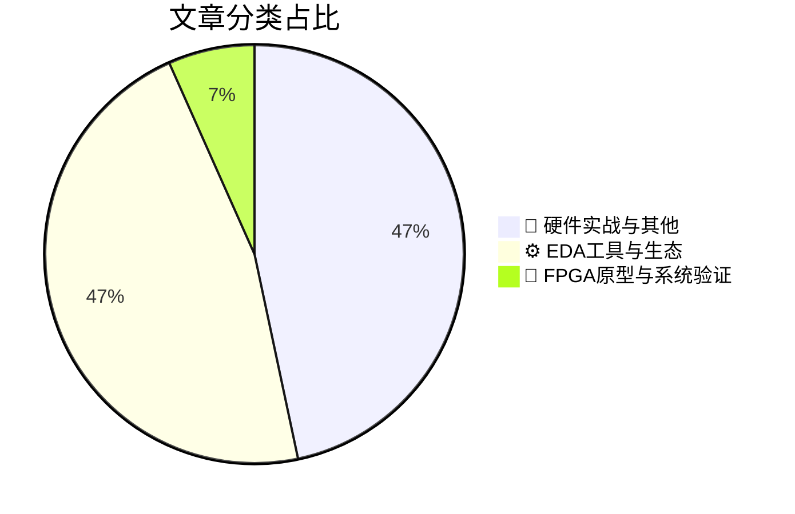

# 🛠️ FPGA / 验证技术精选

> 生成时间：2026-10-19 04:26:30 | 数据范围：过去 96 小时

## 📝 行业视点

 1. **先进封装与互连正从“规格符合”转向“系统级可验证性”**：HBM功耗表征、PCIe Retimer实际链路裕量、CPO热协同仿真以及自动化Via插入，表明带宽、信号完整性、热耦合和可靠性必须在封装—芯粒—板级联合建模中闭环验证。  
2. **Agentic AI正在重构芯片设计与验证流程**：从自主芯片设计、cuLitho加速计算光刻，到嵌入式调试分析和RF数字孪生，AI已由辅助工具演进为可执行设计空间搜索、实时优化和故障归因的工程代理，但可解释性、约束收敛和认证证据仍是落地瓶颈。  
3. **异构计算基础设施趋向标准化与平台化**：AMBA C2C、CPU-GPU协同、可配置AI基础设施及多厂商夹具测试平台共同指向开放互连、模块化验证和供应链弹性，验证重点也从单IP功能正确性扩展到跨协议、跨封装和跨厂商的系统级一致性。

---

## 🏆 深度必读 (Top 3)

### 1. [HBM 功耗特性分析（苏黎世联邦理工学院、纽约大学）](https://semiengineering.com/characterization-of-hbm-power-consumption-eth-zurich-nyu/)
**评分**: 8/10 | **分类**: 📝 硬件实战与其他 | **标签**: `HBM` `功耗表征` `内存架构` `带宽与能效` `系统级测量`

> **💡 推荐理由**：推荐验证团队阅读，因为HBM的峰值带宽并不等同于稳定的能效表现，实际功耗会显著受到访问粒度、读写比例、并发请求和数据流模式影响。文章中的表征方法和实测结论可用于构建或校准HBM功耗模型，补充RTL仿真与架构仿真中常见的功耗估算偏差，并帮助团队设计覆盖不同流量模式和极端功耗场景的验证用例。

**摘要**：
本文围绕高带宽内存（HBM）的功耗特性开展系统性表征，分析内存访问行为、数据传输带宽、读写模式及并发度对功耗和能效的影响。文章重点解决验证团队在HBM功耗建模中缺乏实测数据、难以区分静态功耗与动态功耗，以及难以评估不同访问模式对功耗影响的痛点。通过实验测量和工作负载分析，研究为HBM功耗估算、性能功耗权衡及系统级内存架构设计提供了依据。相关结果还可用于校准仿真模型，识别高功耗访问模式，并指导带宽调度、数据布局和功耗管理策略。对于采用HBM的FPGA、AI加速器和高性能计算系统，本文有助于建立更接近真实硬件行为的功耗验证方法。

### 2. [超越规范：究竟是什么决定了 PCIe 重定时器的传输距离？](https://semiengineering.com/beyond-the-specification-what-really-determines-pcie-retimer-reach/)
**评分**: 7/10 | **分类**: 📝 硬件实战与其他 | **标签**: `PCIe Retimer` `链路预算` `信号完整性` `通道损耗` `PCIe链路训练`

> **💡 推荐理由**：推荐验证团队阅读，因为文章能够帮助团队建立从规范合规到真实链路可靠性的系统验证思路，识别仅靠协议测试难以暴露的模拟裕量、通道损耗、抖动、温度和互操作性风险。它还可为验证计划中的最差通道建模、Retimer 级联测试、链路训练覆盖、误码率测试以及跨厂商平台验证提供架构层面的依据。

**摘要**：
文章探讨了 PCIe Retimer 的实际传输距离并不只由 PCIe 规范中的速率、通道损耗和级联数量决定，还受到芯片模拟前端能力、均衡策略、时钟架构、封装与 PCB 走线、连接器以及系统拓扑等因素的共同影响。它重点解决了仅依据规范参数评估链路裕量，导致实验室通过但真实系统中出现误码、训练失败或互操作性问题的验证痛点。文章强调应从端到端链路和最差工作条件出发，联合分析信号完整性、协议训练行为、抖动、功耗、温度和不同厂商设备之间的互操作性。对于 Retimer 架构设计，核心问题是如何在满足插损预算的同时合理规划 Retimer 位置、级联方式、均衡能力和验证覆盖范围。最终，PCIe Retimer 的可达距离应通过系统级测量、仿真和压力测试共同确定，而不能简单由单一规范指标推导。

### 3. [共封装光学的热协同仿真测试](https://semiengineering.com/thermal-co-simulation-testing-of-co-packaged-optics/)
**评分**: 7/10 | **分类**: ⚙️ EDA工具与生态 | **标签**: `共封装光学` `热-系统协同仿真` `CPO` `热管理验证` `系统级验证`

> **💡 推荐理由**：推荐给负责CPO、先进封装或高速互连的验证团队，可借鉴其热协同仿真思路，补足传统功能验证对热耦合覆盖不足的问题，并在设计早期识别可能影响性能、可靠性和系统稳定性的风险。

**摘要**：
文章聚焦共封装光学（CPO）系统的热协同仿真测试，讨论如何验证光引擎与交换芯片等组件在紧密集成后的热交互。其要解决的痛点是：单独分析器件或依赖静态热模型，难以覆盖真实工作负载下温度变化对系统行为的影响。文章探讨将热模型与系统级仿真结合，以评估热耦合、温度分布及其对性能和可靠性的影响。该方法有助于在流片或封装前发现热设计与验证中的问题，并支持架构和散热方案的权衡。对于数字IC/FPGA验证团队，重点在于把热效应纳入系统级验证闭环，而不是将其留到后期物理测试阶段。

---

## 📊 资讯分布与高频标签

## 📋 更多分类好文

### ⚙️ EDA工具与生态

- [**我们距离完全自主的芯片设计还有多远？**](https://semiengineering.com/how-close-are-we-to-fully-autonomous-chip-design/) - *semiengineering.com* (6分)
  > 文章探讨 AI 能在多大程度上自主完成芯片设计，以及从自动化辅助走向端到端自主设计还面临哪些障碍。重点问题包括：如何让 AI 生成的设计满足功能与性能约束，如何验证其正确性，并如何将设计、验证和迭代流程可靠地衔接起来。文章也关注验证在自主设计流程中的作用：自动化可以加快实现与调试，但不能替代严谨的验证闭环和结果审查。整体来看，完全自主的芯片设计仍有距离，更现实的路径是由工程师把关、AI承担重复性任务并逐步扩大自动化范围。

- [**TASKING 借助 winIDEA AI Kit 将可认证的智能代理式 AI 引入嵌入式调试分析**](https://www.eejournal.com/industry_news/tasking-brings-certifiable-agentic-ai-to-embedded-debugging-analysis-with-winidea-ai-kit/) - *eejournal.com* (6分)
  > TASKING 发布 winIDEA AI Kit，将具备代理能力的人工智能引入嵌入式软件调试与分析流程。该方案旨在自动处理调试数据、执行分析任务并辅助定位故障根因，从而减少工程师在复杂日志、追踪信息和运行时行为之间进行人工关联的工作量。文章重点解决了嵌入式验证中故障复现困难、问题定位耗时以及调试分析流程依赖专家经验等痛点。方案强调面向安全关键应用的可认证性，使 AI 辅助分析能够更好地适配汽车及其他受严格功能安全要求约束的开发流程。通过将 AI 能力与 winIDEA 的调试环境结合，验证和开发团队可以提升问题分析效率，同时保留对分析过程和结果的工程控制。

- [**AMBA C2C：以融合的 AMBA 基础推进芯粒间连接**](https://semiengineering.com/amba-c2c-moving-forward-with-a-converged-amba-foundation-for-c2c-connectivity/) - *semiengineering.com* (5分)
  > 文章介绍了 AMBA C2C（Chip-to-Chip）互连方向，旨在以统一且可扩展的 AMBA 基础支持不同芯粒之间的高带宽、低延迟通信。其核心架构设计问题是如何在多芯粒系统中复用成熟的 AMBA 协议与一致性机制，同时适配不同封装、物理链路和系统拓扑。文章关注芯粒间互连的协议互操作性、可扩展性、可靠性以及软硬件生态兼容，减少定制化接口带来的集成复杂度。对验证而言，重点痛点包括跨芯粒链路的协议一致性、流量与背压处理、错误恢复、顺序和一致性维护，以及端到端数据完整性验证。通过建立收敛的 AMBA C2C 基础，可为不同实现提供更明确的接口契约和统一的验证边界。

- [**通过自动化通孔插入增强先进节点互连**](https://semiengineering.com/strengthening-advanced-node-interconnects-through-automated-via-insertion/) - *semiengineering.com* (4分)
  > 文章探讨了在先进工艺节点中，通过自动化通孔插入提升芯片互连结构强度、可靠性和制造良率的方法。随着线宽缩小、互连密度提高，通孔缺失、连接脆弱、局部电阻增大以及电迁移和制造规则违规等问题更容易出现，传统依赖人工检查或后期修复的流程难以及时覆盖。自动化通孔插入能够结合版图规则、互连拓扑和可靠性约束，在适当位置补充冗余通孔，并减少对时序、拥塞和布线资源的不利影响。文章的核心架构设计问题是如何将通孔增强策略纳入自动化物理实现与验证流程，同时在可靠性收益和设计代价之间取得平衡。该方法还需要通过规则检查、版图一致性分析以及电气和可靠性 sign-off 验证来确认插入结果不会引入新的缺陷。

- [**构建更具选择性和灵活性的 AI 基础设施**](https://semiengineering.com/building-ai-infrastructure-for-greater-choice-and-flexibility/) - *semiengineering.com* (4分)
  > 文章围绕如何构建能够支持多种技术路线、硬件平台和软件生态的 AI 基础设施展开。其核心问题是避免架构过度绑定单一供应商、加速器或部署环境，从而降低迁移成本并提升系统的可扩展性与适应性。文章强调通过模块化、开放接口和可组合的基础设施设计，为不同 AI 工作负载提供更灵活的资源配置与部署选择。对于验证工作而言，这意味着需要覆盖多平台兼容性、软硬件协同、资源调度、性能扩展以及故障隔离等关键场景。由于未提供文章正文，以上内容依据标题所表达的主题进行概括。

- [**Siemens 借助 NVIDIA cuLitho 变革面向下一代 AI 半导体的计算光刻技术**](https://www.eejournal.com/industry_news/siemens-transforms-computational-lithography-for-next-generation-ai-semiconductors-with-nvidia-culitho/) - *eejournal.com* (3分)
  > 文章介绍 Siemens 如何将 NVIDIA cuLitho 的 GPU 加速能力引入计算光刻流程，以应对下一代 AI 芯片先进工艺中版图规模庞大、光刻模型复杂以及计算迭代时间过长等问题。其核心目标是提升光学邻近修正（OPC）和光刻验证相关计算的吞吐量，缩短从版图设计到制造签核的周期。对验证架构而言，这解决了传统 CPU 集群在大规模版图分析、热点识别和多轮参数优化中面临的性能瓶颈、资源扩展成本高及反馈延迟长等痛点。文章也体现了验证工具从单纯依赖通用计算资源向 GPU 加速、异构计算和软硬件协同架构演进的趋势。

### 🔬 FPGA原型与系统验证

- [**智能体人工智能与射频数字孪生：实时重塑 6G**](https://www.eejournal.com/fish_fry/agentic-ai-and-rf-digital-twins-6g-redesigned-in-real-time/) - *eejournal.com* (6分)
  > 文章探讨将智能体人工智能与射频数字孪生结合，用于实时设计和优化 6G 无线系统。数字孪生可在虚拟环境中模拟射频链路及网络行为，帮助团队在实体部署前评估设计变化。智能体人工智能能够依据仿真反馈自主迭代配置，缩短设计探索周期。该方法针对传统验证依赖耗时仿真与实体测试、难以覆盖复杂动态无线场景的问题，并关注如何让系统适应实时变化的运行条件。核心架构挑战是让数字孪生与真实射频系统保持足够一致，并支撑可靠、快速的闭环优化。

### 📝 硬件实战与其他

- [**智能体式人工智能改变CPU与GPU的平衡**](https://semiengineering.com/agentic-ai-alters-the-cpu-gpu-balance/) - *semiengineering.com* (4分)
  > 仅根据文章标题判断，文章可能讨论Agentic AI（智能体式人工智能）兴起后，CPU与GPU在计算任务分工、系统架构和资源配置上的重新平衡。智能体工作负载通常包含复杂的规划、工具调用、控制流和多轮推理，可能提高CPU在调度、编排与通用计算中的重要性，同时继续依赖GPU承担大规模并行模型计算。文章可能聚焦于如何重新设计异构计算架构，以降低数据搬运、调度开销和端到端延迟。由于未提供文章正文或链接，无法准确确认其具体论据、验证痛点及架构结论。

- [**Terafab 的单一屋檐：决定大规模量产的不是光刻，而是封装**](https://semiwiki.com/semiconductor-manufacturers/374838-terafabs-single-roof-why-packaging-not-lithography-decides-high-volume/) - *semiwiki.com* (4分)
  > 文章指出，在高算力芯片和先进系统进入大规模量产时，决定产能、良率与交付速度的关键往往不是单纯的光刻工艺，而是封装、组装、测试和供应链能否形成统一且高效的生产体系。先进封装需要协调晶圆、芯粒、基板、互连、散热和最终测试等多个环节，任何一个环节的瓶颈都可能限制整条产品线的实际产出。文章以 Terafab 的“单一屋檐”模式为核心，强调通过集中管理和垂直整合降低跨供应商协作、物流转运、接口标准不一致以及质量追溯带来的风险。对验证架构而言，这一趋势提出了跨芯粒、跨封装层级和跨测试阶段的协同验证问题，需要建立覆盖功能、互连、热、电源完整性、可靠性和量产测试数据的端到端验证体系。文章最终说明，面向高产量的竞争力取决于封装制造能力与验证、测试、良率学习闭环的整体效率，而非某一项孤立的制程指标。

- [**Testblox推出小型多供应商平台，支持夹具内功能测试**](https://www.eejournal.com/industry_news/testblox-launches-small-form-factor-multi-vendor-platform-for-in-fixture-functional-test/) - *eejournal.com* (4分)
  > 文章介绍Testblox推出的小型化多供应商平台，用于在测试夹具内部执行功能测试。该平台针对夹具内测试空间受限、需要集成不同供应商测试资源，以及将功能测试纳入既有测试流程的架构需求。其小型化设计有助于在有限空间内部署测试能力，多供应商架构则为系统配置和扩展提供灵活性。文章重点呈现该平台如何支持夹具内功能测试，但未提供具体性能指标或兼容性清单。

- [**没有工程师是一座孤岛（蝴蝶效应：工程版）**](https://www.eejournal.com/article/no-engineer-is-an-island-the-butterfly-effect-engineering-edition/) - *eejournal.com* (3分)
  > 文章强调，在复杂芯片和FPGA项目中，任何一个工程决策都可能通过接口、时序、验证环境和团队协作链路产生连锁影响。它聚焦于解决模块各自为战、局部优化引发系统级回归、需求变更影响难以追踪以及验证责任边界不清等痛点。文章倡导工程师从系统视角理解设计约束，强化跨团队沟通、依赖管理和早期验证，从而及时识别小改动对整体行为的潜在影响。对于验证架构而言，这意味着需要建立可复用、可观测且能覆盖跨模块交互的验证环境，并将风险分析、回归策略和结果反馈纳入统一流程。最终目标是降低集成阶段才暴露问题的概率，提高缺陷定位效率和项目交付的可预测性。

- [**芯片行业周报**](https://semiengineering.com/chip-industry-week-in-review-160/) - *semiengineering.com* (2分)
  > 文章聚焦一周内芯片行业的重要动态、技术进展、企业动向及市场变化。它可能帮助读者梳理先进工艺、芯片架构、EDA工具、IP生态和供应链变化对研发项目的影响。从验证视角看，文章关注的核心问题应包括复杂SoC带来的验证周期延长、软硬件协同验证困难、仿真与形式验证资源受限，以及量产前质量风险控制。通过汇总行业趋势，文章为验证架构设计、验证环境演进和项目风险识别提供背景依据。

