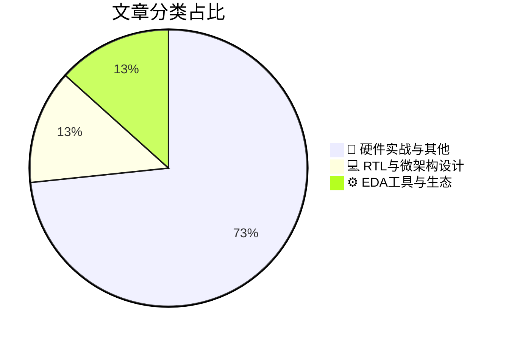

# 🛠️ FPGA / 验证技术精选

> 生成时间：2026-10-26 14:51:46 | 数据范围：过去 96 小时

## 📝 行业视点

当前硬件验证领域正加速从传统PVT表征向真实工作负载驱动的PVTW范式演进，以精准捕获动态功耗、热效应与时序违例，显著提升硅后验证覆盖率与可靠性。EDA工具链深度融合神经网络加速3nm nanosheet SPICE仿真，并突破EPE预算构建下一代计算光刻，大幅压缩先进节点验证周期与精度瓶颈。与此同时，自对准CFET技术推动CMOS缩放突破10Å极限，结合3D Compute-In-Memory的安全感知层映射与硅光子调制器实现200Gb/s PAM4低DSP互联，共同驱动异构架构的故障脆弱性降低与系统级验证复杂度跃升。

---

## 🏆 深度必读 (Top 3)

### 1. [PVTW：将硅片表征从PVT扩展到真实世界工作负载](https://semiengineering.com/pvtw-extending-silicon-characterization-from-pvt-to-real-world-workload/)
**评分**: 6/10 | **分类**: 📝 硬件实战与其他 | **标签**: `PVTW` `Silicon Characterization` `PVT` `Real-World Workload` `Post-Silicon`

> **💡 推荐理由**：强烈推荐给验证团队，尤其是从事后硅验证、功耗/性能表征和可靠性分析的工程师。该方法直接针对当前验证痛点——PVT覆盖不足导致的现场失效风险，能帮助团队构建更贴近实际的验证架构，减少迭代成本并提升芯片良率和用户体验。

**摘要**：
传统硅片表征主要依赖PVT（工艺、电压、温度）角点测试，但忽略了真实应用工作负载对芯片功耗、性能、时序和可靠性的动态影响，导致实验室结果与实际部署场景存在显著偏差。本文提出PVTW方法，通过将真实世界工作负载（Workload）集成到硅片表征流程中，扩展了传统PVT框架，实现更全面的后硅验证覆盖。该方法解决了验证架构中“静态角点测试无法捕捉动态行为”的核心痛点，特别是在复杂SoC和FPGA设计中工作负载相关的电压降、热效应和老化问题。通过实际案例展示，PVTW能更准确地预测芯片在真实场景下的行为，提升验证效率和产品质量。总体而言，它为数字IC/FPGA验证提供了从实验室到现场的桥梁，强化了架构级验证策略。

### 2. [“性能” Oryon：高通的小核](https://chipsandcheese.com/p/performance-oryon-qualcomms-little)
**评分**: 6/10 | **分类**: 💻 RTL与微架构设计 | **标签**: `Oryon微架构` `Qualcomm小核` `CPU流水线` `性能分析`

> **💡 推荐理由**：推荐给验证团队，因其精准指出Oryon小核在性能验证中的关键痛点（如异构同步与功耗仿真），可直接指导FPGA原型验证、覆盖率收敛和性能计数器检查，提升团队对先进SoC自定义核心的验证效率和架构理解。

**摘要**：
本文深入剖析了高通Oryon自定义CPU架构中“小核”（Little Core）的性能设计细节与实现机制。文章重点解决了异构多核系统中小核在能效与性能平衡上的架构挑战，揭示了如何通过微架构优化实现高性能输出。针对验证痛点，详细讨论了性能模型准确性验证、功耗-性能权衡仿真以及多核同步测试中的难点。通过基准测试数据展示了小核在特定负载下的实际表现，并提出针对性的验证策略优化建议。这为数字IC验证工程师提供了自定义ARM核心验证的实践洞察。

### 3. [安全感知层映射降低3D存内计算中的故障脆弱性（亚利桑那州立大学，马里兰大学）](https://semiengineering.com/security-aware-layer-mapping-reduces-fault-vulnerability-in-3d-compute-in-memory-asu-u-of-maryland/)
**评分**: 5/10 | **分类**: 💻 RTL与微架构设计 | **标签**: `3D-CIM` `Security-Aware Mapping` `Fault Vulnerability` `Layer Mapping`

> **💡 推荐理由**：该工作直接针对3D CIM新兴架构的安全验证盲点，提供了可落地的层映射策略与故障脆弱性评估方法，有助于验证团队构建更全面的安全验证框架、完善故障注入测试用例，并提前识别架构级安全风险。

**摘要**：
本文针对3D Compute-In-Memory（CIM）架构中因层间耦合和垂直堆叠导致的故障注入攻击脆弱性问题，提出了一种安全感知的层映射方法。该方法通过优化数据与计算层的映射策略，最小化敏感信息在易受故障影响层的暴露，从而显著降低故障攻击成功率。文章解决了传统CIM验证中难以量化多层结构安全风险、以及缺乏系统性故障脆弱性评估的架构设计痛点。实验结果表明，该映射技术在保持计算效率的同时，有效提升了系统对故障攻击的鲁棒性。验证团队可借此建立针对3D CIM的安全感知验证流程，覆盖层映射相关的故障模型与攻击场景。

---

## 📊 资讯分布与高频标签

## 📋 更多分类好文

### 📝 硬件实战与其他

- [**芯片缩放超越晶体管**](https://semiengineering.com/chip-scaling-moves-beyond-the-transistor/) - *semiengineering.com* (4分)
  > 文章指出随着晶体管物理极限逼近，芯片缩放正从单纯晶体管微缩转向先进封装、芯粒异构集成和3D堆叠等系统级方法。这解决了摩尔定律放缓带来的性能密度瓶颈，但引入了多die互连、电源/信号完整性及热管理等全新架构设计挑战。验证痛点集中在传统单芯片RTL/门级验证无法覆盖跨die协议、系统级协同仿真和封装级时序/功耗验证的复杂性。文章强调需构建分层验证架构，结合虚拟原型、硬件加速和形式化方法来应对异构系统正确性保证。这些转变要求验证团队从芯片级思维升级到系统级多物理域验证策略。

- [**硅光子调制器实现200 Gb/s PAM4并减少DSP（东京科学大学、横滨、AIST、PETRA）**](https://semiengineering.com/silicon-photonic-modulator-reaches-200-gb-s-pam4-with-reduced-dsp-science-tokyo-yokohama-aist-petra/) - *semiengineering.com* (3分)
  > 该文章报道了一种硅光子调制器，成功实现了200 Gb/s的PAM4传输速率，同时显著降低了对数字信号处理（DSP）的依赖。这一成果直接解决了高速光互连系统中DSP复杂度过高导致的功耗、延迟和验证资源消耗过大的架构痛点。通过优化调制器结构和驱动设计，减少了均衡、预加重等算法需求，从而简化了电子-光子接口的信号完整性验证和算法功能验证流程。文章还探讨了在FPGA/ASIC验证环境中如何高效测试低DSP需求的调制器性能，降低了高波特率仿真的时间和计算负担。这为验证团队提供了针对硅光子与数字IC协同验证的新架构思路，尤其适用于数据中心光模块的高速SerDes验证场景。总体而言，它针对了光子集成电路验证中DSP开销与系统级验证效率之间的核心矛盾。

- [**自对准CFET技术如何将CMOS缩放扩展至10 Å以外**](https://semiengineering.com/how-self-aligned-cfet-technology-could-extend-cmos-scaling-beyond-10-a/) - *semiengineering.com* (3分)
  > 文章深入分析了自对准互补场效应晶体管（CFET）技术通过垂直堆叠nFET与pFET，突破传统FinFET/GAA的平面缩放瓶颈，实现超越10 Å节点的晶体管密度与性能提升。它重点解决了先进工艺中器件对准误差、寄生电容剧增以及互连延迟恶化等架构设计难题，提出自对准制造流程以最小化工艺变异。对于验证架构师而言，这直接针对超先进节点中3D器件建模不准确、寄生提取复杂度飙升以及多物理场耦合验证困难等痛点。文章强调需更新仿真模型与验证方法论，以准确捕获CFET独特的电学特性、功耗与可靠性行为。通过自对准方案，有效缓解了堆叠结构中的变异性验证与时序收敛挑战，为持续CMOS缩放提供可行路径。

- [**Mivium公司CEO Eric Tsai访谈**](https://semiwiki.com/ceo-interviews/374522-ceo-interview-with-eric-tsai-of-mivium/) - *semiwiki.com* (3分)
  > 本文是对Mivium公司CEO Eric Tsai的深度访谈，聚焦数字IC与FPGA验证领域的核心挑战。文章明确指出传统验证流程在处理超大规模SoC和异构架构时面临的痛点，包括仿真性能瓶颈、功能覆盖率收敛困难以及验证环境可扩展性不足。Eric Tsai详细阐述了Mivium提出的创新验证架构设计，通过模块化验证IP、智能激励生成和硬件加速协同来系统性解决这些问题。访谈还分享了实际项目中如何将验证周期缩短并显著降低逃逸缺陷率的实践经验。整体内容为验证架构师提供了从痛点诊断到架构落地的完整思路。

- [**RaiderChip公司Victor Lopez高管访谈**](https://semiwiki.com/ceo-interviews/374846-executive-interview-with-victor-lopez-of-raiderchip/) - *semiwiki.com* (3分)
  > 本文通过与RaiderChip的Victor Lopez的高管访谈，深入探讨了数字IC/FPGA验证架构中的核心挑战。文章重点指出了传统仿真方法在复杂SoC和多时钟域设计中覆盖率不足、调试周期过长以及可重用性差的痛点。Lopez分享了RaiderChip采用的分层验证架构，结合UVM环境和形式验证技术，有效解决了低功耗和高速接口验证难题。他还强调了硬件加速仿真与自动化回归的集成，以提升大规模FPGA项目的验证效率。整体内容为验证团队提供了从痛点分析到架构落地的实用指导，帮助应对设计复杂度日益增长的问题。

- [**干沉积抗蚀剂在EUV和电子束曝光下表现出不同的色调行为（KU Leuven、Kunsan、VUB、Imec）**](https://semiengineering.com/dry-deposited-resist-shows-different-tone-behavior-under-euv-and-e-beam-exposure-ku-leuven-kunsan-vub-imec/) - *semiengineering.com* (2分)
  > 本文揭示干沉积抗蚀剂在EUV与电子束曝光下呈现截然不同的正/负色调转换行为，通过实验表征其化学与物理机制差异。该发现直接针对先进节点混合光刻工艺中抗蚀剂响应不一致导致的图案保真度验证难题。文章解决了验证架构中缺乏跨曝光源统一模型的痛点，尤其是OPC校正与掩模数据准备阶段的工艺变异预测不准问题。研究结果为构建更精准的光刻感知仿真框架提供数据支撑，帮助验证团队提前识别制造缺陷风险。这有助于优化数字IC/FPGA物理验证流程中的DFM检查与良率预测架构。

- [**芯片产业一周回顾**](https://semiengineering.com/chip-industry-week-in-review-161/) - *semiengineering.com* (2分)
  > 本文汇总了芯片行业本周关键动态，涵盖先进节点工艺进展、AI芯片设计挑战及供应链波动等核心议题。文章重点揭示了复杂SoC验证中的覆盖率收敛困难与仿真性能瓶颈等具体痛点。针对异构多芯片架构，深入讨论了跨die接口同步验证与协议一致性检查的架构设计难题。同时介绍了新一代EDA工具在形式验证加速和UVM方法论优化方面的突破。这些内容直接关联验证效率提升与可验证性设计改进。整体为验证架构师提供了应对当前行业趋势的实践洞察。

- [**与灾难规避专家公司CEO Gleb Tsipursky博士的访谈**](https://semiwiki.com/ceo-interviews/375036-ceo-interview-with-dr-gleb-tsipursky-of-disaster-avoidance-experts/) - *semiwiki.com* (2分)
  > 本文通过采访Disaster Avoidance Experts的CEO Dr. Gleb Tsipursky，深入探讨认知偏见如何导致项目决策失误和灾难性后果。文章指出验证团队常因确认偏见、过度自信等心理陷阱，忽视边界条件覆盖或架构风险，造成硅后逃逸和重流片。它提供了结构化决策框架和偏见缓解工具，帮助优化验证计划制定与架构评估流程。核心解决了验证架构中因人为因素导致的覆盖盲区和风险管理失效问题。通过实际案例展示如何将灾难规避策略应用于FPGA/IC验证生命周期，提升团队决策质量。最终强调预防性验证文化对降低项目失败率的关键作用。

- [**AJ Cooper 是 Itera 的联合创始人兼首席执行官**](https://semiwiki.com/ceo-interviews/374969-aj-cooper-is-the-co-founder-and-ceo-of-itera/) - *semiwiki.com* (2分)
  > 本文介绍了 Itera 联合创始人兼 CEO AJ Cooper 的背景及其在数字 IC/FPGA 验证领域的实践经验。文章重点剖析了传统验证流程中仿真效率低下、覆盖率收敛困难以及复杂 SoC/FPGA 设计调试周期过长等核心痛点。Cooper 提出基于迭代式架构和智能验证平台的解决方案，强调通过自动化约束生成、形式化辅助与可扩展验证环境来优化架构设计。内容详细阐述了如何构建高效的验证方法论，以应对多时钟域、高并发和异构系统带来的挑战。最终，文章展示了这些方法如何显著缩短验证周期并提升团队生产力。

- [**ITEN首席执行官Vincent Cobée访谈**](https://semiwiki.com/ceo-interviews/373751-ceo-interview-with-vincent-cobee-of-iten/) - *semiwiki.com* (2分)
  > 本文通过与ITEN CEO Vincent Cobée的深度访谈，聚焦固态微电池技术在物联网与边缘设备中的集成挑战。文章针对低功耗数字IC设计中电源完整性与能量管理验证的核心痛点，提出了微功率系统架构优化方案。Cobée详细阐述了如何通过创新电池接口简化FPGA原型中的电源域交叉验证流程。讨论了在SoC验证中模拟电池动态行为的架构难题及其解决方案。强调了跨模拟-数字边界的验证覆盖率提升策略。整体为验证工程师提供了应对新兴电源技术的实用架构指导。

### ⚙️ EDA工具与生态

- [**神经网络加速3nm纳米片SPICE仿真（慕尼黑工业大学）**](https://semiengineering.com/neural-networks-speed-3nm-nanosheet-spice-simulation-tu-munich/) - *semiengineering.com* (3分)
  > 本文提出利用神经网络作为代理模型，显著加速3nm纳米片晶体管的SPICE电路仿真。传统SPICE仿真在先进纳米片工艺中面临多栅结构、量子效应和复杂物理模型导致的计算复杂度极高、仿真时间过长的核心痛点，严重制约设计迭代与验证效率。通过数据驱动训练神经网络替代部分耗时求解过程，可在保持高精度的同时实现数倍至数十倍加速。该方法直接解决了验证架构中因器件级仿真瓶颈导致的大规模电路验证与蒙特卡洛分析缓慢问题。实验结果验证了其在真实3nm节点下的适用性与准确性。

- [**超越EPE预算：构建下一代计算光刻**](https://semiengineering.com/beyond-the-epe-budget-building-the-next-generation-of-computational-lithography/) - *semiengineering.com* (3分)
  > 文章指出在先进工艺节点中，传统基于EPE预算的验证方法已无法充分覆盖计算光刻中的复杂光学邻近效应、随机波动和多物理场耦合问题，导致仿真精度与工艺窗口预测出现显著偏差。它深入分析了现有验证架构在处理大规模OPC/ILT模型时面临的计算瓶颈、收敛性差以及硬件加速不足等痛点。作者提出下一代计算光刻系统需采用异构计算与AI驱动的架构设计，以实现更高精度的全芯片验证与实时误差补偿。核心解决了如何在严格EPE约束下构建可扩展、可验证的光刻仿真与校正流程问题。通过新架构案例，展示了验证效率提升与边缘放置误差控制的显著改进。

