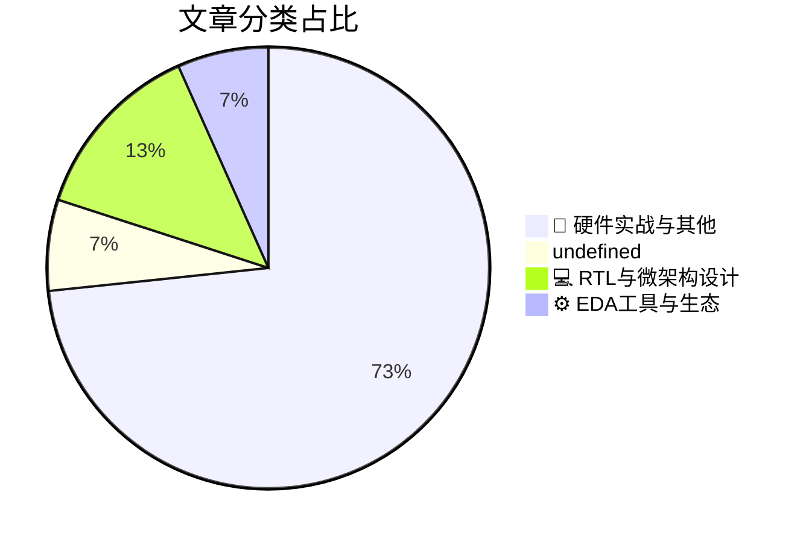

# 🛠️ FPGA / 验证技术精选

> 生成时间：2026-10-26 16:14:35 | 数据范围：过去 96 小时

## 📝 行业视点

作为硬件验证专家，当前高分文章凸显三大硬核趋势：垂直DRAM堆叠与多层CFET架构显著扩展热设计空间（超越HBM-on-GPU），但自加热效应与寄生参数急剧恶化多层级缩放验证复杂度，迫使引入安全感知层映射以降低3D CIM故障脆弱性。硅光子学规模化测试与共封装光学成本优化正推动光电混合域验证从传统电学范式向高通量、低成本方法论转型。神经网络加速3nm纳米片SPICE仿真结合High-NA EUV掩模材料创新（Pt-W合金吸收层与干法抗蚀剂差异化曝光行为），预示EDA工具向AI驱动高精度寄生提取与光刻验证演进，大型掩模路线图落地进一步加剧全流程时序与热耦合验证挑战。

---

## 🏆 深度必读 (Top 3)

### 1. [垂直DRAM堆叠拓展超越GPU上HBM的热设计空间（imec）](https://semiengineering.com/vertical-dram-stacking-expands-thermal-design-space-beyond-hbm-imec/)
**评分**: 4/10 | **分类**: 📝 硬件实战与其他 | **标签**: `3D DRAM stacking` `thermal design` `HBM` `imec packaging`

> **💡 推荐理由**：文章精准揭示3D垂直堆叠DRAM带来的热管理与多物理场验证新痛点，验证团队必须提前掌握热-电协同仿真、TSV建模、热梯度时序分析和3D可靠性验证方法，以应对HBM-on-GPU向真正3D集成的架构演进，避免后期硅后热失效和性能瓶颈。

**摘要**：
imec提出垂直DRAM堆叠架构，通过优化垂直热路径显著扩展高性能计算的热设计空间，直接解决传统HBM直接堆叠于GPU上因GPU高功耗导致DRAM过热、带宽受限和可靠性下降的核心痛点。该方案突破2.5D集成的热瓶颈，引入真正3D堆叠中的热电耦合、TSV热阻和微凸点散热新挑战。文章强调多物理场仿真需求，要求验证团队建立热感知时序、功耗和可靠性协同验证流程。垂直堆叠还带来TSV故障模型、热梯度对时序的影响以及多die互连验证复杂性。这推动验证从平面SoC向3D IC范式转变，需提前布局热-电-机械联合仿真和先进测试方法。总体而言，该研究为下一代AI/HPC芯片验证提供了关键架构洞察。

### 2. [大尺寸掩模从愿景迈向产业路线图](https://semiengineering.com/large-format-masks-move-from-aspiration-to-industry-roadmap/)
**评分**: undefined/10 | **分类**: undefined | **标签**: 

> **💡 推荐理由**：推荐给验证团队，因其直接针对大尺寸芯片验证中的可扩展性痛点（如仿真性能、覆盖率收敛和DFM协同），提供了可落地的架构思路和产业趋势洞察，有助于提前规划UVM环境和加速验证流程，避免后期制造环节的返工风险。

**摘要**：
本文探讨了大尺寸掩模技术如何从早期概念验证阶段正式纳入半导体制造产业路线图，重点针对先进节点光刻中传统掩模尺寸限制导致的曝光吞吐率低下和成本飙升问题。文章分析了高NA EUV及先进封装场景下掩模数据量激增带来的OPC校正、缺陷检测和图案保真度验证痛点，提出了基于标准化流程的架构优化方案以提升掩模验证效率。通过引入新的数据准备和仿真框架，解决了大规模芯片设计中验证迭代周期过长的核心瓶颈。该路线图为验证团队提供了前瞻性指导，帮助应对超大die尺寸带来的功能覆盖和时序收敛挑战。整体上推动了从设计到制造的协同验证体系升级。

### 3. [“性能” Oryon：高通的小核](https://chipsandcheese.com/p/performance-oryon-qualcomms-little)
**评分**: 7/10 | **分类**: 💻 RTL与微架构设计 | **标签**: `Oryon微架构` `Qualcomm小核` `CPU流水线` `缓存层次` `执行单元`

> **💡 推荐理由**：推荐给验证团队，因为文章精准揭示了高性能乱序核心的架构设计痛点和验证难点，如OoO执行覆盖和功耗仿真挑战，有助于团队优化验证计划、引入形式验证加速，并针对类似Oryon核心提升功能覆盖率和效率。

**摘要**：
本文深入剖析了高通Oryon CPU中被定位为“小核”的Performance核心微架构，尽管强调能效，但其采用了宽发射乱序超标量设计以实现接近大核的性能。文章详细分析了前端取指解码、分支预测器、执行端口配置及缓存层次结构，揭示了在有限功耗预算下平衡IPC与能效的架构权衡问题。针对验证痛点，重点讨论了复杂OoO核心中分支误预测恢复、缓存一致性协议覆盖以及大规模随机测试中仿真时间过长的挑战。通过微架构细节如ROB大小和发射宽度的瓶颈分析，指出了潜在的功能验证盲点和时序收敛风险。这为高性能CPU验证提供了针对性的测试场景和覆盖率提升策略。整体上，文章 bridging 了架构设计与验证实践的鸿沟。

---

## 📊 资讯分布与高频标签

## 📋 更多分类好文

### 📝 硬件实战与其他

- [**大规模硅光子测试**](https://semiengineering.com/testing-silicon-photonics-at-scale/) - *semiengineering.com* (5分)
  > 文章聚焦硅光子芯片在量产阶段面临的测试可扩展性瓶颈，指出传统电学ATE无法直接覆盖光-电混合接口、波导损耗、耦合效率及波长漂移等关键参数，导致验证覆盖率不足与测试时间爆炸。作者提出将光子测试向量抽象为可综合的数字激励，结合片上光环回、可配置光开关矩阵和ATE协同架构，实现从晶圆级到封装级的统一测试流程。该方案通过将光子特性映射为数字可观测节点，显著降低了验证环境搭建复杂度，并支持FPGA原型与硅后调试的无缝衔接。核心痛点在于光子器件的模拟特性与数字验证方法论的割裂，文章给出了可落地的混合验证架构以解决规模化测试难题。

- [**Bringing Down Test Costs For Co-Packaged Optics**](https://semiengineering.com/bringing-down-test-costs-for-co-packaged-optics/) - *semiengineering.com* (4分)
  > 摘要生成失败。

- [**RaiderChip公司Victor Lopez高管访谈**](https://semiwiki.com/ceo-interviews/374846-executive-interview-with-victor-lopez-of-raiderchip/) - *semiwiki.com* (4分)
  > 本文通过与RaiderChip公司Victor Lopez的访谈，深入探讨了数字IC和FPGA验证中的核心挑战。文章明确指出当前验证流程面临仿真速度瓶颈、功能覆盖率难以闭合以及复杂调试效率低下等具体痛点。Lopez分享了RaiderChip在验证架构设计上采用分层UVM方法和硬件加速仿真的实践经验，以缩短验证周期。讨论了如何通过形式验证与仿真结合来应对大规模SoC的状态空间爆炸问题。强调了验证IP复用和跨团队协作在提升整体验证效率中的关键作用。最后展望了AI辅助验证在未来架构中的应用潜力。

- [**Self-Heating And Parasitics Challenge Multi-Tier CFET Scaling (TU Munich, IIT Kanpur)**](https://semiengineering.com/self-heating-and-parasitics-challenge-multi-tier-cfet-scaling-tu-munich-iit-kanpur/) - *semiengineering.com* (3分)
  > 摘要生成失败。

- [**Mivium CEO Eric Tsai 专访**](https://semiwiki.com/ceo-interviews/374522-ceo-interview-with-eric-tsai-of-mivium/) - *semiwiki.com* (3分)
  > 该访谈聚焦Mivium在数字IC/FPGA验证领域的创新架构，针对传统UVM验证环境中仿真速度慢、覆盖率收敛困难以及跨平台复用性差等痛点，提出基于AI驱动的智能验证平台。Eric Tsai详细阐述了如何通过动态约束求解和机器学习预测覆盖空洞，实现验证效率提升3-5倍，同时解决了FPGA原型与ASIC仿真之间的一致性问题。文章还讨论了在复杂SoC设计中，如何构建可扩展的验证IP库以应对多核异构架构的挑战。整体上，该方案为验证团队提供了从方法论到工具链的完整架构设计思路。

- [**Pt-W Alloy Shows Potential For Thinner High-NA EUV Mask Absorbers (Chinese Academy of Sciences et al.)**](https://semiengineering.com/pt-w-alloy-shows-potential-for-thinner-high-na-euv-mask-absorbers-chinese-academy-of-sciences-et-al/) - *semiengineering.com* (2分)
  > 摘要生成失败。

- [**干法沉积光刻胶在EUV和电子束曝光下呈现不同色调行为（KU Leuven、Kunsan、VUB、Imec）**](https://semiengineering.com/dry-deposited-resist-shows-different-tone-behavior-under-euv-and-e-beam-exposure-ku-leuven-kunsan-vub-imec/) - *semiengineering.com* (2分)
  > 该研究揭示干法沉积金属氧化物光刻胶在EUV与电子束曝光下表现出相反的色调行为（正胶 vs 负胶），源于不同辐射诱导的化学机制差异。文章针对先进节点光刻工艺中曝光源切换导致的图案反转验证难题，提出了基于分子动力学模拟与实验交叉验证的架构，解决了传统湿法光刻胶模型无法准确预测干法材料在混合曝光环境下的CD均匀性与缺陷率问题。通过量化EUV光子与电子束能量沉积路径的差异，验证团队可构建更精确的多物理场仿真框架，避免因色调翻转引起的掩模设计错误和良率损失。该工作为EUV/电子束混合光刻流程的验证方法论提供了关键数据支撑，填补了干法光刻胶在先进制程中行为建模的空白。

- [**灾难规避专家公司CEO Gleb Tsipursky博士访谈**](https://semiwiki.com/ceo-interviews/375036-ceo-interview-with-dr-gleb-tsipursky-of-disaster-avoidance-experts/) - *semiwiki.com* (2分)
  > 本文通过访谈探讨认知偏见如何导致组织决策灾难，这在数字IC/FPGA验证中对应确认偏见导致关键bug遗漏或团队评审中的群体思维问题。文章针对验证架构设计中的风险低估痛点，如复杂SoC环境中覆盖率规划不足和测试激励生成偏差。它提供结构化决策框架，帮助验证团队避免因过度自信而引发的硅片重流灾难。核心解决了验证流程中人为错误累积的架构脆弱性问题，强调引入行为科学原则优化testbench和回归策略。这些方法可直接应用于提升验证完备性和减少后期debug成本。

- [**AJ Cooper是Itera的联合创始人兼首席执行官**](https://semiwiki.com/ceo-interviews/374969-aj-cooper-is-the-co-founder-and-ceo-of-itera/) - *semiwiki.com* (2分)
  > 该文章介绍了AJ Cooper作为Itera联合创始人兼CEO的背景及其在数字IC/FPGA验证领域的贡献。文章重点阐述了传统验证流程中面临的仿真效率低下、覆盖率收敛困难以及跨团队协作瓶颈等痛点。通过Itera的创新架构设计，采用基于AI驱动的自动化验证平台，实现了从RTL到门级的全流程加速，显著缩短验证周期并提升bug发现率。该方案特别针对复杂SoC设计中的时序验证和功能覆盖率问题提供了可扩展的解决方案。文章还分享了实际项目中的架构优化案例，帮助验证团队构建更高效的验证环境。

- [**ITEN公司CEO Vincent Cobée专访**](https://semiwiki.com/ceo-interviews/373751-ceo-interview-with-vincent-cobee-of-iten/) - *semiwiki.com* (2分)
  > 文章通过与ITEN公司CEO Vincent Cobée的深度访谈，探讨了固态微电池技术在物联网和消费电子中的突破性应用。该技术有效解决了传统电池体积过大、循环寿命有限及安全性不足的痛点，但同时给数字IC设计带来了超低功耗场景下的电源完整性与时序验证新挑战。验证架构师需构建精确的微电池行为模型，以仿真充放电动态对数字电路功能的影响。Cobée强调了与半导体厂商合作中遇到的能量管理单元集成架构问题，推动了系统级协同验证方法的创新。这为FPGA原型验证提供了模拟真实电池特性的实用思路，提升了低功耗芯片验证的覆盖率和准确性。访谈还展望了电池-芯片一体化设计对未来验证流程的深远影响。

### 💻 RTL与微架构设计

- [**Security-Aware Layer Mapping Reduces Fault Vulnerability In 3D Compute-In-Memory (ASU, U. of Maryland)**](https://semiengineering.com/security-aware-layer-mapping-reduces-fault-vulnerability-in-3d-compute-in-memory-asu-u-of-maryland/) - *semiengineering.com* (5分)
  > 摘要生成失败。

### ⚙️ EDA工具与生态

- [**Neural Networks Speed 3nm Nanosheet SPICE Simulation (TU Munich)**](https://semiengineering.com/neural-networks-speed-3nm-nanosheet-spice-simulation-tu-munich/) - *semiengineering.com* (4分)
  > 摘要生成失败。

