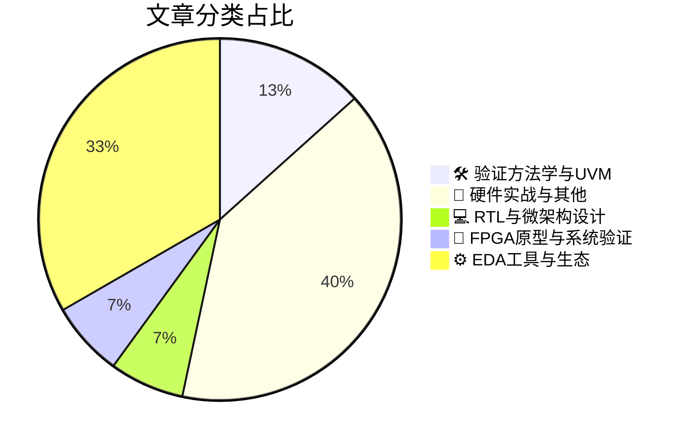

# 🛠️ FPGA / 验证技术精选

> 生成时间：2026-11-02 06:00:51 | 数据范围：过去 96 小时

## 📝 行业视点

当前硬件验证正加速向AI驱动的自主化演进，属性自动生成实现方法论插入，自主根因分析规模化应用于回归分类，显著提升UVM覆盖率与效率。Shift-Left被重新定义，验证从RTL前移并融合电压感知可观测性，从功能监控延伸至系统内测试，以应对微架构比特间交互的复杂性。物理基验证奠定Agentic EDA的信任基石，热效应从signoff专属问题转变为早期多物理场仿真考量，确保极端条件下的鲁棒性。这些趋势叠加监管压力，推动验证向智能化、物理感知与全生命周期合规方向深度融合。

---

## 🏆 深度必读 (Top 3)

### 1. [属性自动生成：方法论插入](https://semiengineering.com/auto-generation-of-properties-methodology-insertion/)
**评分**: 7/10 | **分类**: 🛠️ 验证方法学与UVM | **标签**: `property auto-generation` `assertion insertion` `methodology` `SVA` `formal verification`

> **💡 推荐理由**：强烈推荐验证团队阅读，因其直接针对断言编写效率与质量痛点提供可落地的方法论与架构实践，能显著提升团队生产力、覆盖率和验证可靠性，助力构建更智能的自动化验证体系。

**摘要**：
本文聚焦数字IC/FPGA验证中属性（断言）自动生成的方法论插入问题，针对手动编写SVA/PSL属性耗时、易错且覆盖不全的核心痛点。文章提出系统化架构设计，将自动生成技术无缝嵌入验证流程，实现从规范到属性的自动化转换与工具链集成。通过明确插入点选择、流程优化和覆盖率提升策略，有效减少人为错误并加速验证收敛。该方法论强化了验证架构的可扩展性与可维护性，帮助团队在复杂设计中高效构建高质量属性库。整体解决了传统验证中属性开发瓶颈，推动自动化验证范式落地。

### 2. [规模化自主根因分析用于回归分诊](https://semiengineering.com/scaling-autonomous-root-cause-analysis-for-regression-triage/)
**评分**: 7/10 | **分类**: 🛠️ 验证方法学与UVM | **标签**: `Autonomous RCA` `Regression Triage` `Root Cause Analysis` `Debug Automation`

> **💡 推荐理由**：强烈推荐给验证团队，因其直接解决了大规模回归中最耗时的根因定位瓶颈，提供了可落地的自主架构与工程实践，能有效提升自动化水平、减少人力依赖并加速项目交付，特别适合面临回归爆炸的中大型IC/FPGA团队。

**摘要**：
文章针对数字IC/FPGA验证中大规模回归测试失败分诊的核心痛点，提出了可扩展的自主根因分析（Autonomous RCA）架构。随着设计复杂度和测试用例数量激增，每日回归产生海量失败日志，传统手动分诊依赖专家经验、耗时且难以复现，严重拖累验证周期。方案通过分层日志解析、模式识别与机器学习模型，实现从失败现象到根因的自动化映射与优先级排序。架构设计重点解决了分布式环境下的可扩展性、历史数据关联以及复杂交互场景下的误报问题。最终显著缩短调试时间，提升回归效率，并支持持续集成中的实时自主分诊。

### 3. [重新思考芯片设计中的左移](https://semiengineering.com/rethinking-shift-left-in-chip-design/)
**评分**: 6/10 | **分类**: 📝 硬件实战与其他 | **标签**: `Shift Left` `Verification Strategy` `Early Design`

> **💡 推荐理由**：强烈推荐给验证团队，因为文章精准击中当前数字IC/FPGA验证中的关键架构痛点与效率瓶颈，提供了可落地的左移再思考方法和验证架构优化思路，能直接帮助团队提升早期缺陷发现率、缩短验证周期并降低项目风险。

**摘要**：
文章深入分析了传统芯片设计“左移”验证策略在面对现代复杂SoC和FPGA时的局限性，指出早期验证仍常陷入覆盖率不足、系统级bug发现滞后以及软硬件协同验证效率低下等核心痛点。它强调单纯将验证前移已不足以应对架构复杂度和上市时间压力，需重新审视左移理念并在架构设计阶段就集成形式验证、虚拟原型和加速仿真等先进方法。通过案例展示如何更早暴露架构缺陷，从而大幅降低后期调试成本和风险。文章进一步提出优化验证架构的实践框架，平衡投入与收益，帮助团队构建更智能、持续的验证流程。最终呼吁验证工程师从被动测试转向主动架构级验证，以应对日益严峻的设计挑战。

---

## 📊 资讯分布与高频标签

## 📋 更多分类好文

### 💻 RTL与微架构设计

- [**比特之间的复杂性**](https://semiengineering.com/the-complexity-between-the-bits/) - *semiengineering.com* (6分)
  > 本文深入探讨了数字IC和FPGA设计中比特级操作所带来的验证复杂性，特别是在协议处理、数据打包/解包以及跨时钟域交互中的细微差异。它指出传统验证方法往往忽略比特间的边界条件和时序依赖，导致仿真覆盖率不足和硅后缺陷频发。文章提出了一种分层验证架构，结合形式验证和约束随机激励，以系统性地捕获这些隐藏的复杂性。通过实际案例，展示了如何建模比特级状态机和断言，解决多比特总线一致性检查的痛点。最终，强调了在架构设计阶段提前考虑比特级抽象的重要性，以降低整体验证成本并提升设计鲁棒性。

### 🔬 FPGA原型与系统验证

- [**从功能监控到系统内测试：扩展电压感知可观测性**](https://semiengineering.com/from-functional-monitoring-to-in-system-test-extending-voltage-aware-observability/) - *semiengineering.com* (6分)
  > 本文针对先进工艺下SoC/FPGA设计中电压域复杂、IR drop和动态电压波动难以有效观测的验证痛点，提出将电压感知可观测性从功能监控阶段扩展至系统内测试（In-System Test）。传统功能监控仅覆盖正常运行场景，无法充分暴露测试模式下的电压敏感故障和时序违例。文章通过架构级增强（如电压传感器集成、可观测性网络扩展和测试模式适配），实现了从功能到IST的统一电压监控框架。该方法显著提升了电源完整性相关缺陷的检测覆盖率，并支持在系统级验证中提前发现电压相关可靠性问题。整体方案兼顾了可测性设计（DFT）与运行时监控的协同，为验证架构师提供了可落地的扩展路径。

### ⚙️ EDA工具与生态

- [**基于物理的验证：可信代理式EDA的基石**](https://semiengineering.com/physics-based-validation-the-foundation-of-trustworthy-agentic-eda/) - *semiengineering.com* (5分)
  > 文章指出传统EDA验证依赖抽象模型和仿真，难以捕捉真实物理效应如时序、功耗和工艺偏差，导致代理式AI驱动的EDA工具在复杂芯片设计中产生不可信结果。它提出以物理仿真为核心的验证架构，通过将SPICE级电路仿真、电磁分析和热建模深度集成到验证流程中，解决代理系统在自主决策时缺乏物理真实性的痛点。该方案强调构建多层次物理验证框架，使AI代理能够实时验证设计变更对硅片行为的影响，从而提升从RTL到GDSII的端到端可信度。文章还讨论了如何利用机器学习加速物理仿真，同时保持验证的确定性和可追溯性，以应对先进工艺节点下日益增长的验证复杂度。最终，物理基础验证被定位为构建可靠代理EDA系统的必要基础，避免“幻觉”设计并确保流片成功率。

- [**当失败不是选项时的基于AI的电子设计**](https://www.eejournal.com/article/ai-based-electronic-design-for-when-failure-is-not-an-option/) - *eejournal.com* (5分)
  > 文章针对高可靠性数字IC/FPGA设计中传统验证方法难以覆盖极端场景、仿真周期过长以及功能安全认证成本高昂的痛点，提出将AI驱动的生成式验证与形式化方法深度融合的架构。通过机器学习自动生成针对性测试激励、预测覆盖率空洞并加速回归，同时利用AI辅助的等价性检查和故障注入分析，显著缩短验证周期并提升对罕见失效模式的检测能力。该方案特别适用于汽车、航空和医疗等安全关键领域，解决了传统UVM/SystemVerilog流程在复杂SoC上面临的可扩展性瓶颈。文章还讨论了如何将AI模型嵌入现有验证平台，实现从RTL到门级的全流程智能化，从而在不牺牲确定性的前提下大幅降低人工调试工作量。整体架构强调可解释性和可追溯性，确保AI辅助决策满足ISO 26262等功能安全标准。

- [**AI Raises The Bar For Tomorrow’s Engineers**](https://semiengineering.com/ai-raises-the-bar-for-tomorrows-engineers/) - *semiengineering.com* (4分)
  > undefined

- [**这里是不是越来越热了？为什么热分析不再是签核问题**](https://semiengineering.com/is-it-getting-hot-in-here-why-thermal-is-no-longer-a-signoff-problem/) - *semiengineering.com* (3分)
  > 文章指出传统热分析仅作为签核阶段的事后检查，导致芯片设计中功耗密度过高引发的热热点、时序退化和可靠性问题难以在早期发现和修复，造成昂贵的迭代。通过将热仿真与功耗、时序和物理设计工具深度集成，实现从架构探索到布局布线的全流程热感知设计，验证团队可在RTL或门级阶段就预测并优化热行为。该方法解决了多物理场耦合验证的痛点，使热问题从签核瓶颈转变为可主动管理的设计约束，显著提升先进工艺节点下的一次流片成功率。

- [**CEO Interview with Vera Yang of Flexcompute**](https://semiwiki.com/ceo-interviews/375564-ceo-interview-with-vera-yang-of-flexcompute/) - *semiwiki.com* (3分)
  > 摘要生成失败。

### 📝 硬件实战与其他

- [**欧盟《网络弹性法案》已触及芯片与IP供应商**](https://semiengineering.com/the-eu-cyber-resilience-act-reaches-chip-and-ip-suppliers/) - *semiengineering.com* (3分)
  > 欧盟《网络弹性法案》(CRA)将强制性网络安全要求从软件扩展至硬件芯片与IP核供应商，要求所有数字产品在全生命周期内具备漏洞管理、安全更新和风险评估能力。文章指出验证团队面临的核心痛点是：传统功能验证无法覆盖CRA要求的安全属性（如侧信道防护、固件完整性、供应链可信度），导致现有UVM/SystemVerilog环境缺乏针对CRA合规性的可复用验证IP和覆盖率模型。架构层面需在SoC设计早期引入安全验证分层（硬件信任根、隔离域、加密加速器），并建立从IP交付到芯片量产的持续漏洞扫描与补丁验证流程。验证架构师必须将CRA合规性转化为可量化的断言、形式化证明和硬件仿真场景，否则将面临产品无法进入欧盟市场的风险。

- [**High-NA的讣告来得过早**](https://semiwiki.com/semiconductor-manufacturers/375803-high-nas-obituary-was-premature/) - *semiwiki.com* (3分)
  > 文章驳斥了High-NA EUV光刻技术即将被放弃的传言，强调其在2nm及以下节点仍具核心地位。它针对先进制程中多重图案化导致的布局复杂度激增和验证周期延长这一痛点，提出High-NA通过更高分辨率减少曝光次数。文章分析了随机效应、覆盖精度和3D结构图案化等架构设计挑战，并展示High-NA如何降低DFM规则检查和光刻仿真的迭代负担。验证流程可因此简化时序收敛和良率预测环节。整体论证了该技术对数字IC验证方法论的持续价值。

- [**CEO Interview with Andrew Seddon of CircuitHub**](https://semiwiki.com/ceo-interviews/375343-ceo-interview-with-andrew-seddon-of-circuithub/) - *semiwiki.com* (3分)
  > 摘要生成失败。

- [**指南针：在昨日的心灵中寻找明天**](https://semiwiki.com/general/374750-the-compass-finding-tomorrow-in-the-minds-of-yesterday/) - *semiwiki.com* (3分)
  > 本文提出“指南针”验证方法论，通过挖掘历史项目中的验证数据、覆盖率模式和专家经验，为当前及未来数字IC/FPGA验证提供前瞻性指导。它直接解决了验证团队知识流失、新项目重复造轮子以及难以预测验证重点的核心痛点。文章详细阐述了如何从昨日验证日志和bug报告中提取可复用架构模式，构建智能化、可扩展的测试平台。该方法优化了激励生成和覆盖率闭合流程，显著提升验证效率和bug发现速度。通过实际案例，展示了该框架如何将历史智慧转化为可落地的验证架构创新。总体而言，它为验证工程师提供了一种从过去经验中导航未来挑战的系统性解决方案。

- [**Infinitesima CEO Peter Jenkins专访**](https://semiwiki.com/ceo-interviews/375302-ceo-interview-with-peter-jenkins-of-infinitesima/) - *semiwiki.com* (3分)
  > 该访谈聚焦半导体先进制程中纳米级3D表面计量的验证挑战，Infinitesima的Rapid Probe Microscope（RPM）技术通过高速原子力显微镜实现亚纳米精度的晶圆表面形貌检测，直接解决传统光学或接触式计量在高深宽比结构、EUV光刻缺陷及3D NAND/FinFET工艺中精度不足、吞吐量低的痛点。文章详细阐述了RPM如何集成到产线中，提供实时反馈以优化工艺窗口，从而降低验证周期中因计量误差导致的误判和良率损失。针对FPGA/ASIC验证团队，它强调了将物理计量数据与仿真模型结合的重要性，以应对先进节点下设计-工艺协同验证的复杂性。核心架构创新在于非接触高速扫描与机器学习辅助缺陷分类，显著提升了从设计验证到量产的闭环效率。

