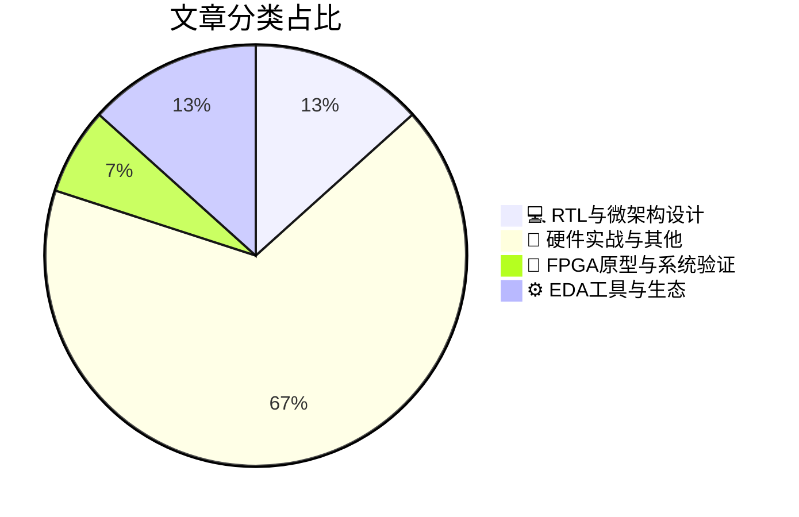

# 🛠️ FPGA / 验证技术精选

> 生成时间：2026-11-09 06:00:57 | 数据范围：过去 96 小时

## 📝 行业视点

作为硬件验证专家，今日高分文章凸显三大硬核技术趋势：边缘AI硬件加速正深度重构RTL与微架构设计，Conv2D模式向实用GPU计算范式转化、AI模型精准适配边缘应用以及STM32H7P等MCU集成DSP/edge-AI/实时控制，迫使验证团队强化功耗-性能-面积协同仿真与异构加速器覆盖率分析。3D-IC信号完整性保护转向系统级方法，结合自动驾驶测试的固有复杂性，推动FPGA原型验证从模块级向全芯片多物理场协同演进，以应对串扰、热效应与时序闭环挑战。同时，AI/HPC数据中心网络安全嵌入与高可靠空间GaN栅极驱动集成，要求验证流程前置安全属性形式化证明与极端环境可靠性应力测试，整体加速硬件验证从传统功能确认向多维度系统韧性保障跃迁。

---

## 🏆 深度必读 (Top 3)

### 1. [将Conv2D转化为实用的GPU计算模式](https://semiengineering.com/turning-conv2d-into-a-practical-gpu-compute-pattern/)
**评分**: 6/10 | **分类**: 💻 RTL与微架构设计 | **标签**: `Conv2D` `GPU compute` `AI accelerator` `dataflow optimization`

> **💡 推荐理由**：强烈推荐验证团队阅读，因其直接针对GPU/加速器中常见的Conv2D验证痛点（内存一致性、并行正确性、边界corner case）给出了实用架构解法，能显著提升验证效率与覆盖率，特别适合AI芯片与FPGA加速器项目。

**摘要**：
本文针对深度学习中核心的Conv2D算子在GPU上落地难的问题，提出了一套将其转化为高效、可扩展计算模式的架构方法。文章重点解决了传统卷积实现中内存带宽瓶颈、线程块映射低效以及边界处理复杂等验证痛点与设计挑战。通过引入优化的数据重排、tiling策略和共享内存复用机制，作者将不规则的卷积计算重构为规整的GPU友好并行模式。该模式显著提升了计算资源利用率，并降低了硬件加速器验证中的覆盖盲区与性能建模难度。整体方案为数字IC/FPGA验证团队提供了可复用的计算内核设计与验证参考，便于在AI加速器项目中快速落地。

### 2. [一种保护3D-IC信号完整性的系统级方法](https://semiengineering.com/a-system-level-approach-to-protecting-3d-ic-signal-integrity/)
**评分**: 5/10 | **分类**: 📝 硬件实战与其他 | **标签**: `3D-IC` `Signal Integrity` `System-Level`

> **💡 推荐理由**：强烈推荐给验证团队：直接针对当前先进封装验证中最棘手的3D-IC SI问题，提供可落地的系统级验证策略与架构思路，能有效弥补传统验证方法在多die协同仿真上的不足，帮助团队提前发现并规避信号完整性风险，提升3D-IC项目一次成功率。

**摘要**：
文章针对3D-IC中因TSV、微凸点和多die堆叠导致的信号完整性（SI）恶化问题，提出系统级保护架构与验证方法。传统2D验证流程难以覆盖垂直互连串扰、电源噪声耦合及热电协同效应，造成后期SI失效风险高。作者通过系统级建模、多物理场协同仿真和早期架构约束，实现从die到package的全链路SI保护。该方法解决了验证团队在3D-IC中面临的跨die信号完整性验证盲区和仿真收敛困难痛点。核心贡献在于将SI保护从局部电路提升到系统架构层面，显著提升验证覆盖率和设计可靠性。

### 3. [将AI模型适配到边缘应用](https://semiengineering.com/fitting-ai-models-to-edge-applications/)
**评分**: 5/10 | **分类**: 💻 RTL与微架构设计 | **标签**: `Edge AI` `Model Optimization` `Hardware Acceleration` `FPGA/ASIC Inference`

> **💡 推荐理由**：强烈推荐验证团队阅读，因其精准剖析了边缘AI部署中量化验证、硬件-软件协同验证及资源约束下的架构痛点，提供了可落地的验证策略与方法论，能直接提升团队在AI加速器与FPGA边缘应用验证中的效率与覆盖率。

**摘要**：
本文聚焦于如何将复杂AI模型有效适配到资源受限的边缘设备（如FPGA/ASIC），解决模型压缩、量化与硬件映射中的核心架构设计问题。文章指出验证痛点在于量化后精度损失难以量化验证、固定点运算引入的数值误差、以及功耗/延迟/面积权衡下的时序与功能正确性验证。通过系统级协同验证方法，确保优化后模型在边缘场景下既满足性能约束又不牺牲可靠性。核心解决了边缘AI加速器从算法到硬件实现的验证鸿沟与架构优化挑战。

---

## 📊 资讯分布与高频标签

## 📋 更多分类好文

### 🔬 FPGA原型与系统验证

- [**为什么自动驾驶测试比看起来更难**](https://semiengineering.com/why-testing-automated-driving-is-harder-than-it-looks/) - *semiengineering.com* (5分)
  > 文章深入剖析了自动驾驶系统测试远超传统IC/FPGA验证的复杂性，核心痛点在于驾驶场景的组合爆炸导致无法穷尽覆盖。边缘案例和罕见安全关键事件极难捕捉与复现，传统覆盖率指标失效。仿真环境与真实世界差距大，硬件在环验证架构面临实时性与保真度挑战。文章指出需构建基于风险的场景生成与智能验证流程，以应对AD SoC/FPGA的安全验证难题。这揭示了验证架构设计中从功能覆盖向场景与安全完整性覆盖转型的必要性。

### 📝 硬件实战与其他

- [**为AI、HPC和数据中心添加网络安全**](https://semiengineering.com/adding-network-security-to-ai-hpc-and-data-centers-2/) - *semiengineering.com* (4分)
  > 文章聚焦于在AI训练集群、HPC系统和超大规模数据中心中集成网络安全功能（如MACsec、IPsec、TLS硬件加速及零信任架构）的架构挑战。它指出了高带宽（400G/800G）网络下安全协议引入的延迟、吞吐下降和功耗激增等核心痛点，以及验证团队面临的协议一致性、侧信道防护和性能回归验证难题。文章提出了硬件安全引擎与网络协议栈深度融合的设计方法，强调可配置安全IP的模块化验证策略。通过案例展示了如何利用形式验证、仿真加速和硬件仿真平台解决复杂安全状态机的覆盖率问题。最终给出了在FPGA原型和ASIC实现中平衡安全强度与系统性能的实用架构建议。

- [**物理AI将硬件推向极限**](https://semiengineering.com/physical-ai-pushes-the-limits-of-hardware/) - *semiengineering.com* (4分)
  > 文章深入探讨了物理AI（如机器人、自动驾驶和边缘智能系统）如何对数字IC与FPGA硬件提出极端要求，包括超低延迟实时推理、极致能效和传感器融合处理。它指出传统冯·诺依曼架构在功耗墙、带宽瓶颈和物理世界交互可靠性方面已达极限，催生存算一体、异构加速器和自适应硬件等新架构。核心验证痛点包括复杂异构SoC的功能覆盖不足、时序与功耗联合收敛困难，以及安全关键场景下的形式验证与故障注入挑战。架构设计问题聚焦于如何验证物理约束下的AI模型硬件映射、实时确定性以及多物理域协同仿真。文章强调需升级验证方法论，结合硬件仿真加速、虚拟原型和AI辅助验证来突破这些极限。

- [**意法半导体STM32H7P MCU嵌入数字信号处理、边缘AI与实时控制，面向苛刻工业应用**](https://www.eejournal.com/industry_news/stmicroelectronics-stm32h7p-mcus-embed-digital-signal-processing-edge-ai-and-real-time-control-for-demanding-industrial-applications/) - *eejournal.com* (4分)
  > 文章介绍了STMicroelectronics推出的STM32H7P系列MCU，通过硬件集成DSP加速器、边缘AI推理引擎和实时控制外设，专为高性能工业应用设计。它解决了传统MCU在多任务并发时DSP计算与AI推理效率低下、实时控制确定性不足的架构设计痛点。核心架构采用异构多核与专用硬件加速，减少软件开销并提升系统响应速度与可靠性。对于验证而言，文章隐含指出了验证此类集成SoC时面临的多域功能交互覆盖难、实时时序约束验证复杂以及边缘AI精度与功耗协同验证的挑战。通过硬件嵌入式方案，有效缓解了软件仿真验证中性能瓶颈和覆盖率不足的问题。整体强调了在工业场景下实现高效、确定性控制的验证策略参考。

- [**芯片产业一周回顾**](https://semiengineering.com/chip-industry-week-in-review-163/) - *semiengineering.com* (3分)
  > 本文汇总了芯片行业本周关键动态，聚焦先进节点SoC与AI加速器设计中的验证挑战。核心痛点包括复杂异构系统仿真速度瓶颈、功能覆盖率收敛困难以及多die/Chiplet集成时的接口协议验证不足。文章分析了传统UVM架构在处理高并发时序与功耗验证时的扩展性局限，并探讨了形式验证与仿真混合方法在安全关键场景的应用短板。同时指出FPGA原型验证在早期软件bring-up中的时序与调试效率问题。这些内容直接针对数字IC/FPGA验证架构师面临的可扩展性与收敛效率设计难题。

- [**为何集成栅极驱动调节对高可靠性空间GaN设计至关重要**](https://semiengineering.com/why-integrated-gate-drive-regulation-matters-for-high-reliability-space-gan-designs/) - *semiengineering.com* (3分)
  > 文章聚焦高可靠性空间应用中GaN功率器件的栅极驱动架构挑战，指出分立式驱动在辐射、温度极端环境下易产生电压漂移与不稳定，导致过压损坏或欠压失效，这是验证中的核心痛点。集成栅极驱动调节通过内置精密稳压与保护电路，实现精确电压控制与抗辐射加固，显著提升系统可靠性并简化BOM。它解决了架构设计中驱动方案选择与辐射硬化保证的关键问题，强调需在验证中覆盖SEU、电压精度漂移及长期老化效应。文章为验证团队提供了针对空间级GaN电源设计的验证策略指导，帮助识别并缓解关键失效模式。整体提升了高可靠性设计的可验证性与覆盖率。

- [**大学毕业生与人工智能**](https://semiengineering.com/college-grads-and-ai/) - *semiengineering.com* (3分)
  > 文章深入分析了AI技术如何重塑大学毕业生进入数字IC/FPGA验证领域的路径与挑战。它指出了验证团队面临的核心痛点：新毕业生在复杂SoC/FPGA验证架构设计、覆盖率闭环和调试效率上的技能鸿沟，导致上手周期长、生产力低。文章提出利用AI辅助工具（如智能测试生成、断言推荐和异常检测）来重构验证流程，降低新人学习曲线。通过案例展示了AI如何帮助毕业生快速掌握UVM/SystemVerilog高级验证方法学，解决传统手工验证中的可扩展性与一致性问题。最终强调验证架构需融入AI协同设计，以应对人才短缺并提升整体验证质量与效率。

- [**CEO Interview with Mark Rushworth of Finchetto**](https://semiwiki.com/ceo-interviews/375759-ceo-interview-with-mark-rushworth-of-finchetto/) - *semiwiki.com* (3分)
  > 摘要生成失败。

- [**Kneron CEO Albert Liu 访谈**](https://semiwiki.com/ceo-interviews/375923-ceo-interview-with-albert-liu-of-kneron/) - *semiwiki.com* (3分)
  > 本文通过采访Kneron CEO Albert Liu，深入探讨了边缘AI芯片的架构设计与验证挑战。文章重点指出了NPU异构计算中神经网络加速器的验证痛点，包括动态工作负载下的功能覆盖不足、功耗-性能权衡验证复杂性以及软硬件协同仿真的瓶颈。Liu分享了公司在低功耗AI SoC设计中采用的分层验证策略和FPGA原型验证方法，以解决时序收敛和接口兼容性问题。核心内容还涉及如何通过架构创新应对快速模型迭代带来的回归验证压力，强调了早期系统级验证的重要性。这些见解直接针对数字IC验证中AI加速器特有的架构设计难题。

- [**Electroninks公司CEO Brett Walker访谈**](https://semiwiki.com/ceo-interviews/375666-ceo-interview-with-brett-walker-of-electroninks-2/) - *semiwiki.com* (3分)
  > 本文通过采访Electroninks CEO Brett Walker，深入探讨了粒子自由导电墨水技术在先进电子制造中的创新应用。该技术直接解决了传统粒子基导电材料在打印电路和互连中导致的堵塞、不均匀导电性和可靠性缺陷等痛点，这些缺陷常引发FPGA原型板和数字IC系统中的信号完整性与时序验证失败。文章重点分析了如何通过新型材料优化互连架构设计，减少物理原型迭代中的验证开销。它还讨论了将增材制造工艺集成到验证流程中的架构策略，以提升系统级可靠性仿真的准确性。最终，提供了加速硬件验证闭环并降低流片风险的实用见解。

### ⚙️ EDA工具与生态

- [**意法半导体简化STM32开发者的AI模型开发**](https://www.eejournal.com/industry_news/stmicroelectronics-streamlines-ai-model-development-for-stm32-developers/) - *eejournal.com* (4分)
  > 文章介绍了STMicroelectronics通过更新STM32Cube.AI和相关工具链，显著简化了在资源受限的STM32 MCU上开发和部署AI模型的流程。它重点解决了传统边缘AI开发中模型量化精度损失、手动优化耗时以及硬件资源匹配困难等验证痛点。通过自动化神经网络转换、优化和C代码生成，减少了架构设计迭代中因性能与准确性权衡导致的反复验证工作。验证工程师可借此更高效地验证推理引擎的正确性、时序和功耗约束。整体提升了从训练模型到嵌入式部署的端到端验证效率，降低了边缘AI SoC集成风险。

- [**CEO Interview With Trey Closson of Amplio**](https://semiwiki.com/ceo-interviews/375744-ceo-interview-with-trey-closson-of-amplio/) - *semiwiki.com* (3分)
  > 摘要生成失败。

